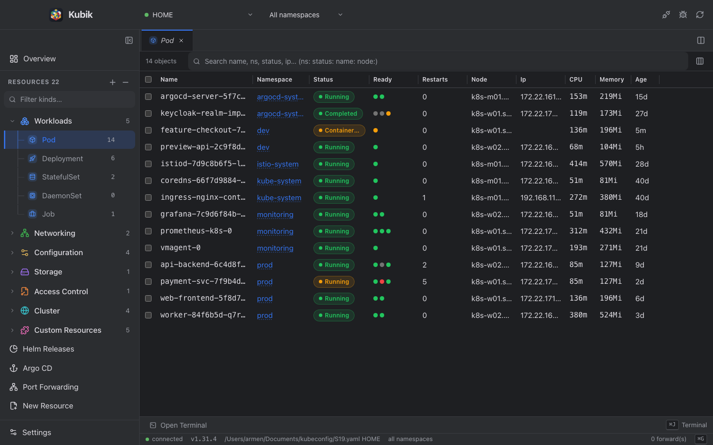
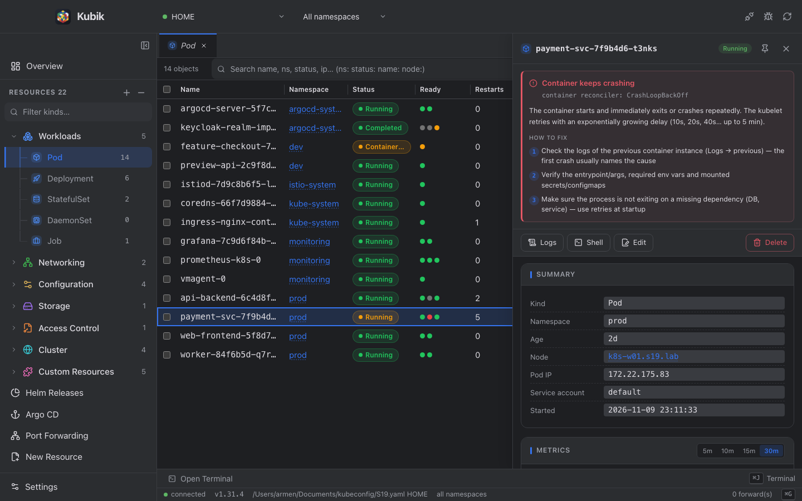
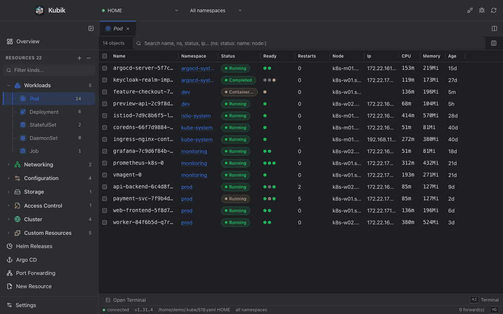
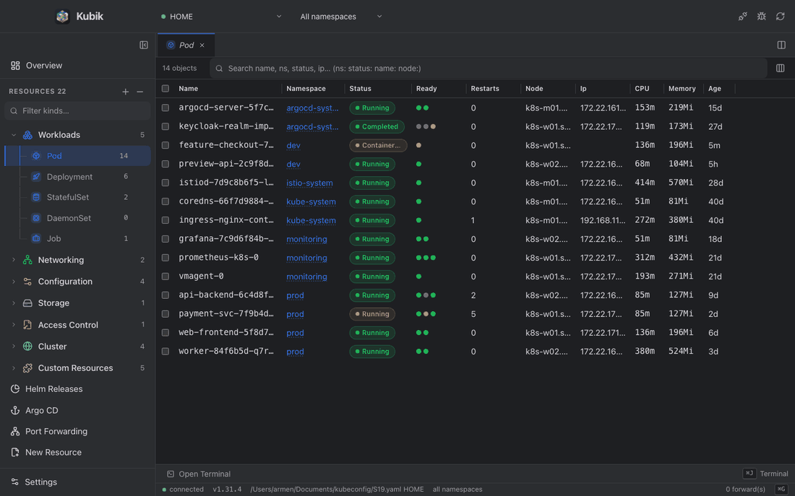
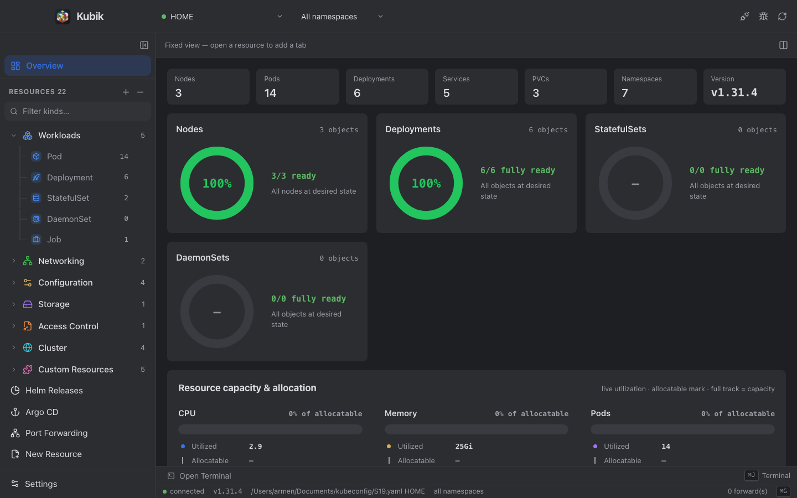
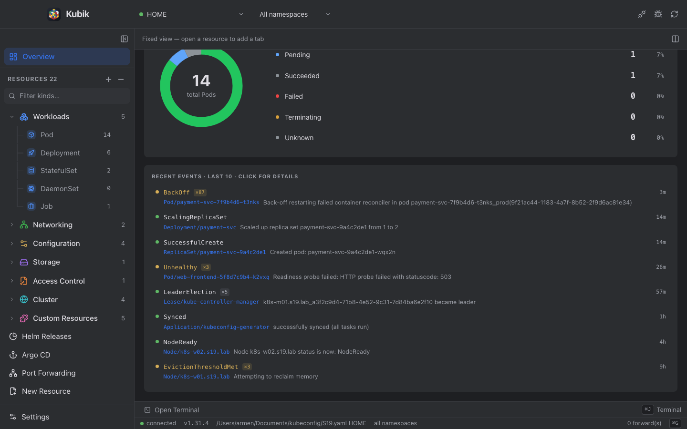
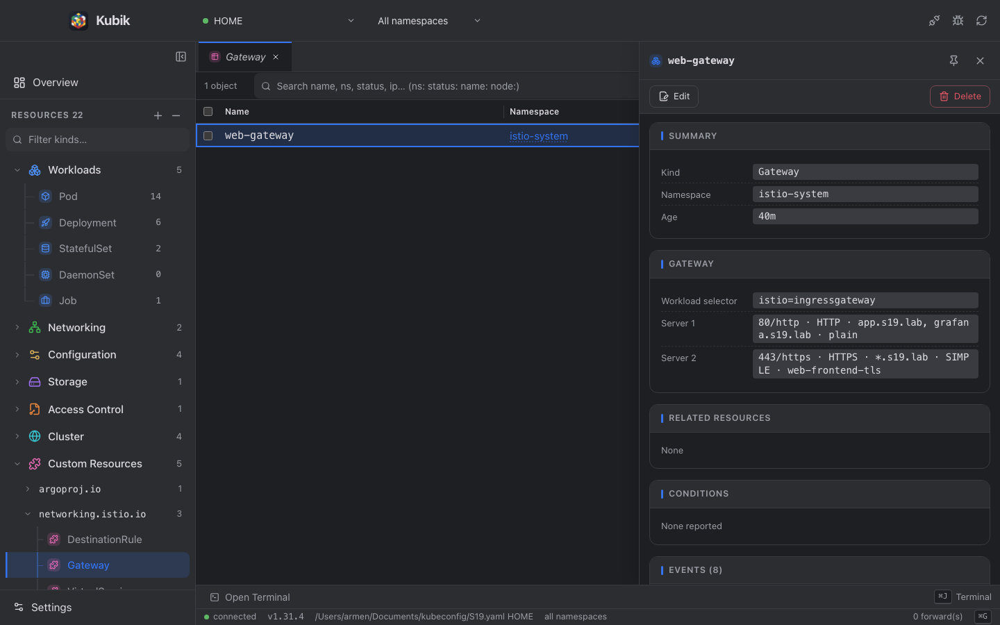
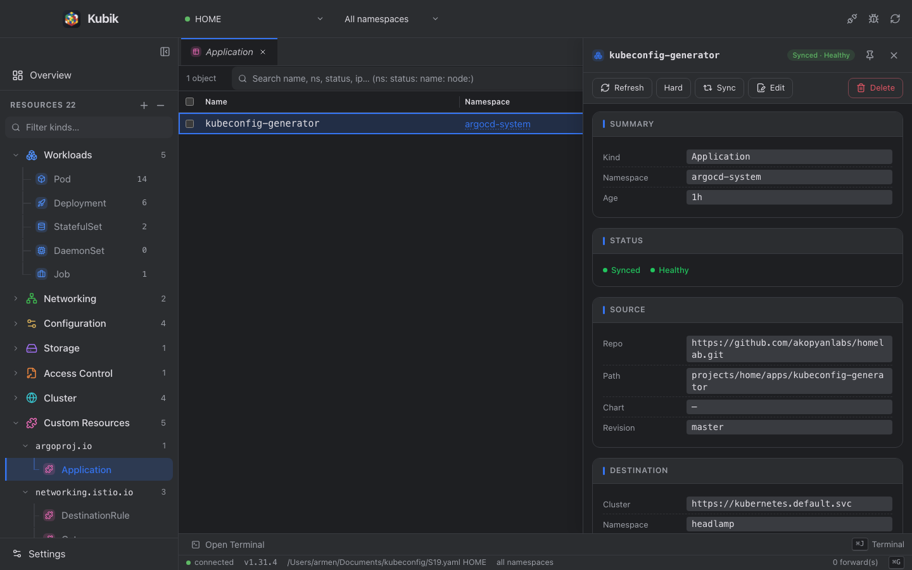

# Kubik

Kubik is a fast, cross-platform desktop cockpit for Kubernetes clusters: a
native Rust core (Tauri 2 + kube-rs) with a React interface. It connects with
your own kubeconfig, streams live resource state, and covers the daily-driver
tooling — YAML editing, logs, shells, port forwarding, Helm. All cluster
traffic goes through the Kubernetes API; a local kubectl is not needed for
browsing, editing or Helm — only for exec credential plugins (see below).


## Download

Grab the latest build from the
[Releases](https://github.com/akopyanlabs/kubik/releases) page:

| File | Platform |
| --- | --- |
| `Kubik_<version>_aarch64.dmg` | macOS (Apple Silicon) — drag-to-Applications installer |
| `Kubik_<version>_x64-setup.zip` | Windows (x64) — zip with an NSIS installer |

To run it you need a kubeconfig with at least one context (`~/.kube/config`,
`$KUBECONFIG` or added in Settings). Optional: a local `helm` binary for the
Helm views and a local `kubectl` for exec credential plugins — both are
auto-detected and can be pinned in Settings → Tools.

## Screens

Captured from the app running against a demo cluster.

















## Features

| Area | Capabilities |
| --- | --- |
| Cluster connection | Multiple kubeconfig files/folders scanned recursively; context picker with per-file credentials; connect/disconnect toggle; cluster health, ping and server version in the debug panel |
| Namespaces | Click a namespace name to switch to it, use checkboxes to build a multi-namespace scope, or watch all namespaces — applied to every view and watch |
| Resource browsing | Full API discovery (built-ins + CRDs, probed group-by-group in parallel), live watch-driven tables with per-container status dots, filter (`ns:` `status:` `name:`), sorting, virtualized rows and per-row context menus |
| Overview dashboard | Stat cards, workload readiness (Deployments/StatefulSets/DaemonSets/Nodes), live CPU/memory/pods capacity, pod distribution, recent events with severity and jump-to-object |
| Object inspector | Summary, crash diagnostics with fix suggestions, containers with probes/resources/launch arguments, volumes, conditions, related objects (pods behind a Service, PVC claims), events — all links navigate to the corresponding object |
| YAML editor | CodeMirror editor with templates, change review diff, and `kubectl edit` semantics: saves PATCH the two-way diff of the buffer (never a full replace), so untouched fields keep their live server state |
| Workload actions | Scale, rollout restart, evict (respects PodDisruptionBudgets), delete — from row context menus |
| Pod logs | Container/init-container picker, history slices, live follow, ANSI colors, wrap toggle, download |
| Pod shells | Interactive exec terminals (xterm.js) with live resize and container switching |
| Host terminal | Local shell in the dock with the active context's KUBECONFIG exported |
| Port forwarding | Pods and Services (resolved through Endpoints/EndpointSlice), auto or explicit local port, session panel |
| Helm | Releases table, revision history, manifests/values/notes viewer, repo management, install/upgrade/rollback/uninstall — via the local Helm binary |
| Argo CD | Application inspector with sync/health status, source, destination, history and managed resources; refresh and sync actions |
| Diagnostics | App event log with severity and kubeconfig filters, connection debug panel (ping, per-group discovery probes, live watch table), force re-discovery |
| Metrics | Pod/node CPU and memory columns and charts via metrics.k8s.io when installed |
| Settings | Kubeconfig paths, theme (dark/light/system), fonts, editor behavior, scrollback, system-API visibility, Helm/kubectl binary paths |

## When is a local kubectl needed?

Only when your kubeconfig authenticates through an **exec credential plugin** —
the `user.exec` block, which is how OIDC/SSO setups (Keycloak, Okta, Dex,
`kubectl oidc-login`, aws/azure/gcp auth, …) distribute credentials:

```yaml
users:
  - name: oidc-user
    user:
      exec:
        command: kubectl
        args: [oidc-login, get-token, --oidc-issuer-url=…]
```

Kubik runs that plugin itself whenever a token is needed:

- On connect, the first access, and automatically **after every 401** — the
  plugin is re-run with a fresh cache (kubelogin then opens the browser for
  the login; after you sign in the cluster connects by itself)
- Token refreshes and re-logins run `kubectl` from the resolved path —
  no manual terminal work

Every other flow — listing, watches, YAML editing, logs, shells, port
forwarding, Helm — talks to the API server directly through kube-rs and
needs **no kubectl at all**. If your kubeconfig uses client certificates,
tokens or auth-provider blocks, kubectl is not used either.

## Performance on Windows

The macOS and Windows builds run the same Rust core, so a large gap between
them usually comes from the Windows environment, not the app. The three
most common causes, in order of impact:

1. **Windows Defender real-time protection.** Every process spawn (exec
   credential plugins run `kubectl` on connect) and every network buffer is
   scanned. Add exclusions for:
   - the install directory (`C:\Program Files\Kubik` or per-user
     `%LOCALAPPDATA%\Kubik`)
   - `kubectl.exe` itself
   - the token-cache directory (`%USERPROFILE%\.kube`)
   This is typically the single biggest win — 100–500 ms per spawn disappears.
2. **OneDrive-synced kubeconfigs.** Files on `Desktop`/`Documents` are hydrated
   and re-checked on every read; each connection reads the kubeconfig (and
   re-reads it on mtime change). Keep kubeconfigs in a plain local folder,
   e.g. `%USERPROFILE%\.kube\`.
3. **Network path to the API server / proxy.** Compare the ping shown in the
   debug panel (bug icon → Connection) between macOS and Windows: if Windows
   shows a much higher ms, the difference is the network route (VPN/proxy),
   not the client.

If the pings are similar but tables render slowly, update the **WebView2
Runtime** (`Settings → Apps → WebView2` or `evergreen.sd.microsoft.com`) —
old runtimes have known rendering-performance issues.

## macOS Gatekeeper

Unsigned (ad-hoc) builds downloaded from the internet get quarantined and the
first launch is blocked with "cannot verify the developer". Any of these
unblocks it once:

- Right-click Kubik in Applications → Open → Open
- System Settings → Privacy & Security → scroll to "Open Anyway"
- `xattr -dr com.apple.quarantine /Applications/Kubik.app`

## Attribution

Kubik's visual identity (name and icon) follows the Kubik desktop Kubernetes
IDE; this is an independent implementation written from scratch, communicating
with clusters exclusively through the Kubernetes API.

## License

Apache-2.0
